<p align="center">
  <a href="https://behnaam.com"></a>
</p>

<p align="center">
  <a href="https://behnaam.com"></a>
  <a href="https://linkedin.com/in/behnamjafari"></a>
  <a href="https://www.producthunt.com/@gilebehnam"></a>
  <a href="https://t.me/gilebehnam"></a>
  <a href="https://calendly.com/bjafaribox/30min"></a>
</p>

<p align="center"><b>I turn messy, complex problems into clean systems that scale:</b><br>
products, businesses and platforms that work in the real world and keep working as they grow.</p>

---

### ⚡ Right now: Whalya Venture Studio

I founded **Whalya**, a venture studio. It builds AI products that do real work for small teams, three of them so far:

| Product | What it does | Where |
|:--|:--|:--|
| **[Whalyom](https://github.com/gilebehnam/whalyom)** | Your entire marketing department inside Claude Code: 536 AI agents in 28 departments, 106 commands, 50 rules enforced in code. Nothing goes out without your yes. | [whalyom.com](https://whalyom.com) · open source |
| **[Whalory](https://github.com/gilebehnam/whalory)** | Makes the AI you already use write like a professional copywriter, in English and Persian. | [whalory.com](https://whalory.com) · open-source core |
| **Whalyon** | AI business-health platform that diagnoses root causes, not symptoms. | Live, free launch |

```yaml
studio: Whalya
products: [Whalyom, Whalory, Whalyon]
based_in: Tehran (UTC+3:30)
open_to: [new engagements, relocation]
```

### 🧭 The record

| | |
|:--|:--|
| **18+ years** | across product, operations & ventures |
| **20 ventures** | shipped, scaled or shut down, including the 3 that did not work |
| **1,000B+ Tomans** | gross transaction volume across a precious-metals group *(company-reported)* |
| **0.5 → 10 kg/day** | physical gold & silver volume after moving Shalize off WhatsApp |
| **626K+ users** | in six months: Ketabno, social reading for teenagers |
| **300K users** | in two months: Mastoura, native short-form video |
| **5 platforms** | investor-facing, taken from design to deployment in 2026 |

### 🛠 Selected work: problem first

| Venture | Domain | The problem | What happened |
|:--|:--|:--|:--|
| **Whalyon** | AI · Ops | Businesses treat symptoms, not root causes | Live, free launch phase |
| **Shalize** | Precious metals | A gold business run on WhatsApp and memory | 0.5 → 10 kg/day · 4,000+ verified customers |
| **Ketabno** | Social reading | Teenagers stop reading because it is solitary | Launched in ~3 months · Ministry of Education partner |
| **Invest Iran** | FDI platform | An investment agency with no digital surface | Full investor journey architected |
| **Emkan Atlas** | Trade corridors | Route, port & treaty data scattered | 135 corridors · 2,461 segments · 234 legal records |
| **Iran Vision 2050/65** | Foresight | Long-range vision without traceable numbers | 197 countries benchmarked |
| **WritingChex** | AI EdTech | IELTS candidates with no examiner | MVP with paying users · Founder Institute |

→ **[All 20 ventures, with case studies](https://behnaam.com/work)**

### 🧩 The 5P method

> Five questions I settle before anything gets built. Skipping one is how eighteen months disappear.

`01 Purpose` why does this exist? · `02 Product` smallest proof · `03 People` whose behaviour must change? · `04 Path` first user → thousandth · `05 Place` what the market permits today

### 🧰 Stack I ship with

<p>
  
  
  
  
  
  
  
  
  
  
</p>

### 🎓 Credentials

MBA, Information Systems & IT (IAU Science & Research, in progress) · **Founder Institute** · **Product School** Roadmapping · **McKinsey** *Take a Step Forward* · Management Consulting, UX Architecture, Web Development (Sharif University)

---

<p align="center">
  <b>Have a problem that will not hold still?</b><br>
  Tell me what is broken. If I can help, I will say how.<br><br>
  <a href="mailto:bjafaribox@gmail.com">bjafaribox@gmail.com</a> · <a href="https://calendly.com/bjafaribox/30min">Book 30 minutes</a> · <a href="https://behnaam.com/experience">Full record</a>
</p>

<p align="center"><sub>🇮🇷 بنیان‌گذار ونچر استودیوی والیا · والیوم، والوری، والیون</sub></p>
